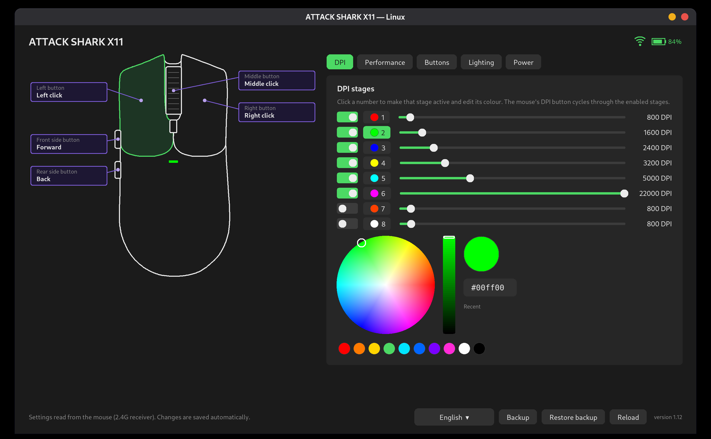
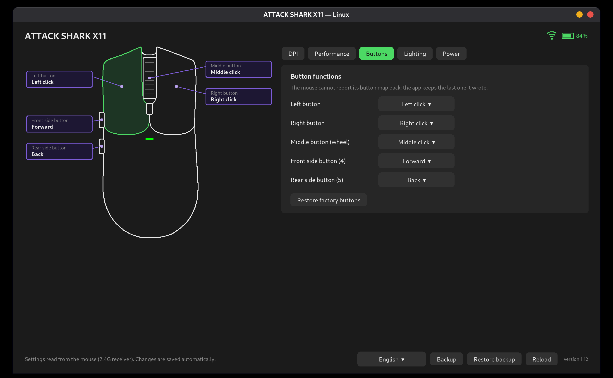
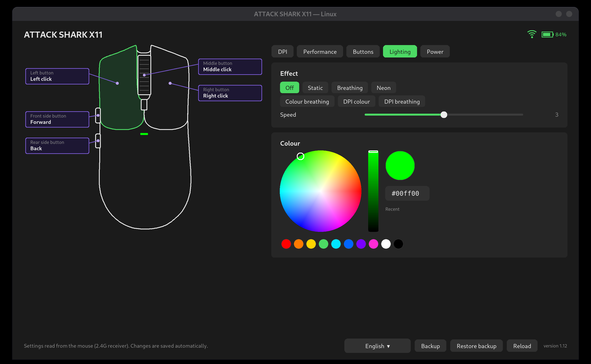

# ATTACK SHARK X11 on Linux

Open-source configurator for the **ATTACK SHARK X11** wireless mouse: a GUI (`x11gui`) and a command-line
tool (`x11ctl`). The official software only runs on Windows; this one talks to the mouse directly over
`/dev/hidraw`, through the 2.4G receiver or the USB cable. Python standard library and Tk only, no daemon.



| Buttons | Lighting |
|---|---|
|  |  |

| What | GUI | CLI |
|---|---|---|
| DPI stages: up to 8, 50–22000 DPI, colour per stage, active stage | ✓ | ✓ |
| Polling rate 125 / 250 / 500 / 1000 Hz | ✓ | ✓ |
| Angle snap, ripple control, button response time (debounce) | ✓ | ✓ |
| Remap the five buttons: mouse functions, DPI, media keys, keyboard shortcuts | ✓ | ✓ |
| Lighting: 7 effects, colour, brightness, speed | ✓ | ✓ |
| Sleep and deep-sleep timers | ✓ | ✓ |
| Battery level and charging state (through the receiver) | ✓ | ✓ |
| Backup / restore (JSON) | ✓ | ✓ |
| English / Brazilian Portuguese interface | ✓ | — |
| Macros | not yet | not yet |

Changes are written as soon as you make them, and only after the mouse confirms each one. The tool only
sends the settings reports the official app sends for the X11; it has no firmware-update code.

## Install

### Debian / Ubuntu (.deb)

Download `sharkx11_<version>_all.deb` from the
[Releases page](https://github.com/MiguelSanzBr/attackshark-x11-linux/releases), then:

```bash
sudo apt install ./sharkx11_0.1.0-beta2_all.deb
```

It installs `x11ctl`, `x11gui`, the menu entry "ATTACK SHARK X11" and the udev rule. Replug the receiver
afterwards.

### Flatpak

From the signed repository at <https://miguelsanzbr.github.io/flatpak/> (updates arrive with `flatpak update`):

```bash
flatpak remote-add --user --if-not-exists miguelsanz https://miguelsanzbr.github.io/flatpak/miguelsanz.flatpakrepo
flatpak install --user miguelsanz io.github.miguelsanzbr.attackshark-x11-linux
```

Each release also has a `.flatpak` file (`flatpak install --user ./file.flatpak`). The app is not on Flathub. Inside the sandbox the app reaches the device through its hidraw node, so
the udev rule is still installed once on the host, from a clone of this repository:

```bash
sudo install -m644 udev/70-attackshark-x11.rules /etc/udev/rules.d/ && sudo udevadm control --reload && sudo udevadm trigger --action=add --subsystem-match=hidraw
```

The AppStream metadata, desktop entry and icon for Flatpak are in `packaging/flatpak/`.

### From source

Requirements: Python ≥ 3.8 and Tk (`python3-tk` on Debian/Ubuntu).

```bash
git clone https://github.com/MiguelSanzBr/attackshark-x11-linux.git && cd attackshark-x11-linux
sudo install -m644 udev/70-attackshark-x11.rules /etc/udev/rules.d/ && sudo udevadm control --reload && sudo udevadm trigger --action=add --subsystem-match=hidraw
pip install .            # or run ./x11gui.py and ./x11ctl.py straight from the checkout
```

The udev rule gives the logged-in user access to the mouse's settings interface (`1d57:fa60` receiver,
`1d57:fa55` cable). Without it you get "permission denied".

## Use

### Graphical interface

```bash
x11gui
```

Click a button on the drawing to change what it does. The tabs hold the DPI stages, performance, lighting
and power settings; the battery shows at the top right. If the mouse is asleep or off when the app starts,
it says so and reads the mouse as soon as it wakes up.

### Command line

```bash
x11ctl info                                   # model, battery, current settings
x11ctl dpi --stages 800,1600,3200 --active 2  # stages 1-3 on, the rest off
x11ctl dpi --colors '#ff0000,#00ff00,#0000ff' --angle-snap off --ripple on
x11ctl polling 1000
x11ctl light --mode breathing --color '#00aaff' --speed 3
x11ctl power --sleep 5 --deep-sleep 30 --debounce 4
x11ctl button forward volume_up               # x11ctl actions lists the actions
x11ctl button back key:ctrl+shift+t
x11ctl buttons --reset
x11ctl backup x11.json && x11ctl restore x11.json
```

The mouse cannot report its button map back, so (like the official app) the last map written is kept in
`~/.config/sharkx11/buttons.json`.

## Good to know

* It's a beta. It only changes settings, never firmware. Make a backup first (`x11ctl backup file.json`).
* Tested on an X11 through its 2.4G receiver: every setting above was written, confirmed by the mouse, read
  back, seen working (light colour, remapped button) and kept after switching the mouse off and on. The USB
  cable path follows the same protocol but was not tested yet.
* The official app supports 18 ATTACK SHARK models behind the same receiver; this tool was written for and
  tested on the X11 (model id 0x55). Other models are detected and named, but their settings layouts were
  not checked.
* Above 20000 DPI the sensor only has a code every ~170 DPI, so two neighbouring 100-DPI steps can read
  back as the same value.
* Not affiliated with ATTACK SHARK. No code or artwork from the official app is included; the mouse outline
  was traced from the silhouette of its product picture.

## How it works

The protocol (feature reports 0x04 DPI, 0x05 lighting/power, 0x06 polling, 0x08 buttons, the 0xA0 read
request, the `03 55 50 00` write confirmation and the battery heartbeat) is written up in
[docs/PROTOCOL.md](docs/PROTOCOL.md).

## Development

```bash
python3 -m venv .venv --system-site-packages && .venv/bin/pip install -e ".[test]"
.venv/bin/python -m coverage run -m pytest -q && .venv/bin/python -m coverage report
```

The tests run against `tests/fake_mouse.py`, an emulator of the mouse behind its receiver, and never touch
real hardware. Coverage is 100% (lines and branches).

## License

MIT
